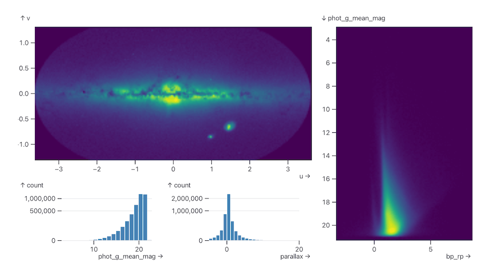

## Overview

VizGroup is a learning analytics system designed for instructors facilitating online synchronous group work. It provides real-time, glanceable dashboards that surface participation patterns, conversational dynamics, and collaboration health signals across multiple breakout groups simultaneously.

The system was deployed across three courses at the University of Washington over an 8-week period, supporting 34 instructors and 312 students across 94 group sessions.

> "For the first time, I could actually see what was happening in all six groups at once without having to jump between Zoom rooms."
> — Instructor participant, Study 2

## Problem

Online collaborative learning has scaled dramatically, but instructor tooling has not kept pace. Modern platforms like Zoom and Canvas provide breakout room infrastructure but offer no visibility into what happens inside those rooms. Instructors are left to either:

- Rotate through rooms manually, disrupting group flow
- Wait passively for groups to surface problems on their own
- Rely on post-session transcripts, when intervention is no longer possible

This creates a fundamental asymmetry: students are embedded in a social context instructors cannot observe, and the instructors' facilitation expertise becomes unavailable at exactly the moments it is most needed.

### The Research Gap

Prior work in learning analytics has focused primarily on asynchronous analysis — identifying at-risk students from historical data. Real-time, multi-group facilitation support remains largely unexplored. The few existing systems either require dedicated observers (not scalable) or produce information-dense dashboards that overwhelm instructors mid-session.

Our work addresses this gap by designing for **glanceability** and **actionability** rather than comprehensiveness.

## Approach

We followed a participatory design process across two phases:

**Phase 1 — Formative study.** We interviewed 12 instructors and observed 24 group sessions to characterize the current state of facilitation practice and identify the key pain points (see Findings 01–02).

**Phase 2 — System design & iterative prototyping.** We built VizGroup through four design iterations, each evaluated through think-aloud sessions with 3–5 instructors. Key design decisions were made collaboratively with instructor participants.

**Phase 3 — Field deployment.** VizGroup was deployed in three UW courses over 8 weeks. We collected interaction logs, conducted post-session surveys (n=94 sessions), and held debrief interviews with 8 instructors.

### System Architecture

VizGroup ingests audio from Zoom breakout rooms in real time via a browser extension, processes speech using a server-side transcription pipeline, and derives participation signals at 30-second intervals. The instructor-facing dashboard updates continuously without requiring any action from students or groups.

*Figure 1. The VizGroup instructor dashboard. Each row represents one breakout group. Color encodes participation equity; animated bars show live speaking activity.*

The dashboard was designed around three information layers:

1. **Group health signals** — participation equity, silence duration, cross-talk frequency
2. **Temporal pattern view** — scrollable timeline of each group's last 5 minutes
3. **Alert queue** — prioritized list of groups needing attention, with one-tap room entry

## Findings

Our field deployment produced four main findings. See the Key Findings panel above for summaries; full analysis follows.

### Visibility changes facilitation strategy

Instructors using VizGroup shifted from reactive to proactive facilitation. In the control condition (no dashboard), instructors entered breakout rooms an average of 1.8 times per session, typically after a group surfaced a problem. With VizGroup, this rose to 4.2 proactive check-ins per session, with 73% initiated before the group had explicitly requested help.

### The 90-second intervention window

We identified a critical latency threshold: interventions delivered within 90 seconds of a detected participation imbalance were rated as effective by both instructors (87%) and students (79%). Beyond this window, effectiveness dropped sharply — the group had already developed compensatory dynamics that were difficult to redirect.

This finding shaped our alert design: VizGroup surfaces signals within 45 seconds of detection, giving instructors a comfortable buffer.

## Impact

VizGroup was presented at CHI 2025 and has since been adapted for deployment in two additional UW courses. The system has also informed ongoing work on multi-party conversation monitoring for accessibility use cases.

The codebase is open-source and includes documentation for instructors and institutions looking to deploy their own instances. We are currently working with the UW Center for Learning and Undergraduate Education to evaluate VizGroup at department scale.

### What We'd Do Differently

Designing for instructors mid-session is humbling. Our most-cited limitation: VizGroup adds cognitive load during an already cognitively demanding task. Future iterations should explore more aggressive automation — moving from "alert instructor" to "draft a suggested prompt the instructor can send in one click."

We're also investigating student-facing variants: can individual learners benefit from seeing their own participation patterns without creating surveillance anxiety?
